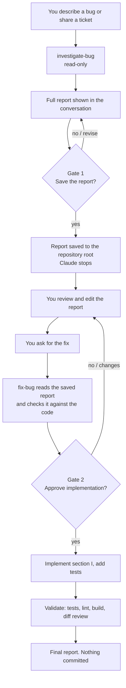

# bug-workflow

A Claude Code plugin for fixing bugs in two controlled steps:

1. **`investigate-bug`** traces a bug to its root cause without changing your files and writes an evidence-based investigation report.
2. **`fix-bug`** implements the fix that report specifies, only after you explicitly approve it.

You can describe a bug in plain language and Claude picks the right skill. You can also run either skill directly with a slash command.

## Contents

- [The workflow](#the-workflow)
- [Using the skills](#using-the-skills)
- [Approval gates](#approval-gates)
- [The investigation report](#the-investigation-report)
- [Install, update, and remove](#install-update-and-remove)
- [Limitations](#limitations)
- [Testing the plugin](#testing-the-plugin)

## The workflow



1. You describe a bug in natural language, or share a GitHub, GitLab, Jira, or other ticket.
2. Claude invokes `investigate-bug`. It reads code, tests, configuration, and Git history, and doesn't modify anything.
3. Claude presents the full investigation report in the conversation.
4. **Gate 1:** Claude asks whether to save the report to the repository root. Nothing is written until you say yes.
5. You review the saved report and edit it however you like. Your edits are authoritative.
6. You ask for the fix. Claude invokes `fix-bug`, which reads the saved report from disk and checks it against the current code.
7. **Gate 2:** Claude shows the exact files it will change and asks you to approve implementation.
8. Claude implements the approved scope with tests, validates it, and reports the results. It never commits or pushes on its own.

## Using the skills

### Natural language (automatic invocation)

Claude Code shows Claude each installed skill's description and loads a skill when your request matches it. You don't need to remember any commands.

| You say | What happens |
| :- | :- |
| "The click event isn't firing for video ads. Can you investigate?" | `investigate-bug` runs, presents a report, and asks Gate 1. |
| "Why does the export button do nothing on Safari?" | `investigate-bug` runs. |
| "Here's the ticket: `https://github.com/acme/shop/issues/482`" | `investigate-bug` fetches the issue with `gh` and investigates. |
| "Implement the approved fix in the investigation report." | `fix-bug` reads the report, confirms the scope, and asks Gate 2 unless you've already explicitly approved. |
| "Investigate this issue and fix it." | `investigate-bug` runs first and stops at Gate 1. The fix waits for Gate 2. |
| "Fix the crash on logout." (no report saved yet) | No files are changed. Claude explains that a fix needs a reviewed report and offers to investigate first. |
| "Look at the login thing." (unclear) | Claude asks whether you want an investigation or an implementation. |

### Slash commands (explicit invocation)

Plugin skills are namespaced by the plugin name:

```text
/bug-workflow:investigate-bug <ticket-url-or-description>
/bug-workflow:fix-bug <report-filename>
```

Examples:

```text
/bug-workflow:investigate-bug https://github.com/acme/shop/issues/482
/bug-workflow:investigate-bug Checkout total shows NaN after applying a coupon
/bug-workflow:fix-bug checkout-total-nan-with-coupon-investigation-report.md
```

A slash command chooses the skill. It doesn't grant any approval: `fix-bug` still asks Gate 2 before editing.

### Ticket access

`investigate-bug` uses whatever is already authorized in your session:

- **GitHub Issues:** the `gh` CLI (`gh auth login`)
- **GitLab Issues:** the `glab` CLI or a connected GitLab MCP server
- **Jira, Linear, and others:** a connected MCP server or an authenticated CLI. Public pages are fetched directly.

If a ticket can't be fetched, Claude tells you why and what would fix it, and asks you to paste the ticket text instead. It never asks for tokens or passwords.

## Approval gates

| Gate | Asked by | You're approving | It does not approve |
| :- | :- | :- | :- |
| Diagnostic | `investigate-bug` | One state-changing diagnostic, such as a test run that writes build output | Saving the report or any code change |
| **Gate 1** | `investigate-bug` | Writing `<bug-title>-investigation-report.md` to the repository root | Implementation |
| **Gate 2** | `fix-bug` | Changing the files listed in the report's section I, plus their tests | Anything outside section I, new dependencies, unapproved API changes, commits |
| Deviation | `fix-bug` | One specific change of plan, shown with evidence | Anything else |

Approval must be explicit and in your own words: "yes, save it", "approved, implement it". Replies like "looks good" or "ok" on their own are treated as review comments, and Claude asks you to confirm. Automatic invocation, slash commands, and earlier approvals never count as implementation approval.

Rules both skills follow:

- Don't overwrite, revert, stash, or reformat your uncommitted work. Report pre-existing changes separately.
- Don't switch branches, stage, commit, push, or rewrite history without your explicit request.
- Label findings as **Confirmed**, **Hypothesis**, **Assumption**, or **Unknown**. Never claim a test ran when it didn't.

### When `fix-bug` stops and asks

`fix-bug` implements the report as written and doesn't silently redesign it. It stops for renewed approval if:

- the current code contradicts the documented root cause;
- the files or interfaces in section I changed materially since the investigation's base commit;
- the approved solution can't be implemented as written;
- the fix needs a new dependency or an unplanned public API change;
- the fix would reach beyond section I.

It explains the evidence, offers options, and waits.

## The investigation report

The report is Markdown, saved as `<bug-title>-investigation-report.md` (lowercase kebab-case) at the repository root, and only after Gate 1. It follows [`templates/investigation-report.md`](templates/investigation-report.md):

| Section | Contents |
| :- | :- |
| Header | Ticket, branch, **base commit SHA**, working-tree state, date, status |
| A. Bug summary | Expected vs actual behavior, reproduction steps, scope, impact |
| B. Root cause | Explanation, code evidence with `path:line`, causal chain |
| C. Current execution flow | Narrative plus a Mermaid diagram |
| D. Other occurrences | Every related occurrence and whether it shares the root cause |
| E. Possible solutions | Options, tradeoffs, and a recommendation |
| F. Proposed implementation | File-by-file changes and API impact |
| G. Test strategy | Normal, edge, failure, and regression tests, plus validation commands |
| H. Risks and open questions | Risks, assumptions, compatibility, open questions |
| **I. Approved implementation specification** | The contract `fix-bug` implements: selected solution, approved source and test changes, excluded scope, dependencies, constraints, required checks, blockers |
| J. Developer review checklist | A checklist for your review |

Edit section I to change what gets implemented. `fix-bug` always reads the saved file, so your edits take effect. The base commit SHA lets `fix-bug` detect code that changed after the investigation.

## Install, update, and remove

Requirements: Claude Code with plugin support (tested with v2.1.314) and `git`.

The plugin is distributed through the **galacticos-labs** marketplace, a catalog hosted at [sakib-shadman/claude-skills](https://github.com/sakib-shadman/claude-skills). You add the marketplace once and install plugins from it by name.

### Install at user scope (all your projects)

In a Claude Code session:

```text
/plugin marketplace add sakib-shadman/claude-skills
/plugin install bug-workflow@galacticos-labs
```

`/plugin install` opens the plugin's details. Choose **Install for you (user scope)** to use it in every project on this machine.

From your shell, without opening a session (user scope is the default):

```bash
claude plugin marketplace add sakib-shadman/claude-skills
claude plugin install bug-workflow@galacticos-labs
```

Check it loaded: type `/bug-workflow:` in a session to see both skills, or run `claude plugin list`.

To use it only in one repository, choose project or local scope in the panel, or pass `--scope project` or `--scope local` to `claude plugin install`.

If you don't have a GitHub SSH key and adding the marketplace or installing fails, set `CLAUDE_CODE_PLUGIN_PREFER_HTTPS=1` and try again.

### Update

Auto-update is off by default for third-party marketplaces. Either:

- turn it on: run `/plugin`, open **Marketplaces**, select `galacticos-labs`, and choose **Enable auto-update**; or
- update manually: run `/plugin marketplace update galacticos-labs` in a session, or `claude plugin update bug-workflow@galacticos-labs` in your shell.

Run `/reload-plugins` or start a new session to load the update. You get a new copy only when the plugin's `version` changes. See [CHANGELOG.md](CHANGELOG.md).

### Disable or remove

```bash
claude plugin disable bug-workflow@galacticos-labs     # keep installed, turn off
claude plugin uninstall bug-workflow@galacticos-labs   # remove the plugin
claude plugin marketplace remove galacticos-labs       # remove the marketplace and all plugins installed from it
```

In a session, `/plugin uninstall` and the **Installed** tab in `/plugin` do the same.

## Limitations

- **Automatic invocation is model-driven.** Claude picks a skill by matching your request to the skill descriptions. In the bundled evals (5 prompts, 3 runs each), every bug report and fix request triggered the right skill and the unrelated request triggered neither, but unusual phrasing may behave differently. Use the slash command when you need certainty. If you have many skills installed, Claude Code may shorten skill descriptions to fit its listing budget, which can reduce matching. `/doctor` shows the listing cost.
- **Commands are namespaced.** The supported form is `/bug-workflow:<skill>`. Claude Code may also accept a bare `/investigate-bug` or `/fix-bug` when no other command uses that name. That isn't guaranteed, so documentation and examples use the namespaced form.
- **Read-only is enforced by instructions, not a sandbox.** `investigate-bug` is told not to modify files, and Claude Code still applies your permission mode to every tool call. For a hard guarantee, run the investigation in plan mode (Shift+Tab). You'll need to leave plan mode for Gate 1 to save the report.
- **Gates are conversational.** Approvals are read from your messages, not from a UI button. Be explicit when you approve.
- **Long sessions.** After context compaction, Claude Code keeps the start of each invoked skill. The critical rules are at the top of each skill, but if behavior drifts in a very long session, invoke the skill again.

## Testing the plugin

The plugin ships an eval suite in [`evals/`](evals/) that runs each case in a fresh, sandboxed session against a small fixture repository with a known bug. It checks that:

- a plain bug report triggers `investigate-bug`, makes no edits, and ends at Gate 1;
- "investigate and fix" investigates first and makes no edits;
- "implement the approved fix" triggers `fix-bug`, reads the report, and asks Gate 2 without editing;
- a fix request with no saved report makes no edits;
- an unrelated feature request triggers neither skill.

Run it from the repository root (it uses your Claude Code credentials and plan usage):

```bash
claude plugin eval . --scaffold \
  --allow-tools Write Edit "Bash(git *)" "Bash(ls *)" \
  --runs 2 --ablation none
```

`--scaffold` runs each case's `scaffold.sh` to build the fixture repository. Write and Edit are granted so the "no edits" checks are meaningful.

## License

MIT. See [LICENSE](LICENSE). Contributions and bug reports are welcome; see [CONTRIBUTING.md](CONTRIBUTING.md).
